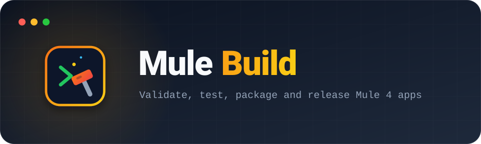

<p align="center">
  
</p>

<p align="center">
  <a href="https://www.npmjs.com/package/@sfdxy/mule-build"></a>
  <a href="https://github.com/Avinava/mule-build/actions"></a>
  <a href="LICENSE"></a>
</p>

<p align="center"><strong>A familiar build path for MuleSoft projects: check, test, package.</strong></p>

`mule-build` wraps the Maven and Mule operations you already use. Node.js is only the small runtime
that starts the command; you do not need to write JavaScript or understand a Node project.

## Install and build

You need Node.js 20.19 or newer, Maven, and a JDK supported by your Mule runtime.

```bash
npm install --global @sfdxy/mule-build@3.1.0
cd my-mule-application
mule-build doctor --operation test
mule-build test
mule-build package
```

Expected finish:

```text
✓ Package built successfully
  Artifact: .../target/my-mule-application-1.0.0-2026-08-26T09-30-00.jar
  Tests: 12 run, 0 failed, 0 skipped
  Duration: 18.4s
  Maven warnings: 0
```

The JAR stays in `target/`. `mule-build` does not publish to Exchange or deploy to CloudHub; use
[`anypoint-connect`](https://avinava.github.io/anypoint-connect/) for those Anypoint operations.

## Pick your path

| If you are… | Start with… |
| --- | --- |
| A MuleSoft developer | [Getting started](https://avinava.github.io/mule-build/getting-started/) and the [sample Orders API](examples/sample-orders-system-api/) |
| Working on MUnit | [Test and package recipes](https://avinava.github.io/mule-build/recipes/) |
| Building CI or releases | [Safe release and CI recipes](https://avinava.github.io/mule-build/recipes/#ci-build) |
| Using Codex, Claude, Copilot, Gemini, or Cursor | [Agent setup](https://avinava.github.io/mule-build/agent-setup/) |
| Looking up flags | [CLI reference](https://avinava.github.io/mule-build/cli/) |

## Commands in Mule terms

| Command | What it means |
| --- | --- |
| `doctor` | Check Maven, POM, Mule/MUnit plugins, source layout, runtime, or Git readiness |
| `test` | Run all MUnit tests or select a suite, test, or tags |
| `package` | Run the Mule Maven package lifecycle and copy the final JAR to `target/` |
| `enforce` | Find secrets that would ship in the JAR: unsecured references, literal credentials, plaintext config values |
| `compat` | Check connectors, `mule-artifact.json`, Maven JDK, and MUnit against the target Mule runtime and Java |
| `run` | Build and deploy to a compatible Mule runtime on your machine |
| `status`, `stop` | Inspect or stop that resolved local runtime |
| `release` | Change the POM version, build, commit, tag, and optionally push |
| `strip` | Directly remove `secure::` prefixes from source XML |
| `mcp` | Let an MCP-capable coding agent call the same operations |

`doctor`, `enforce`, `compat`, `status`, and release `--dry-run` are read-only. Direct `strip` and direct
`release` mutate by default; preview them with `--dry-run`. `package --strip-secure` is different: it
uses an isolated temporary copy and does not edit your source.

## Common examples

```bash
# Build readiness; a local Mule runtime is not required
mule-build doctor --operation build

# One MUnit test
mule-build test --suite orders-test-suite --test list-orders-flow-returns-an-order

# Normal artifact
mule-build package

# Production policy from mule-build.yaml
mule-build package --profile production

# Secrets that would ship in the JAR, and connector/runtime/JDK compatibility
mule-build enforce
mule-build compat

# Release preview: no POM, commit, tag, or remote changes
mule-build doctor --operation release
mule-build release --bump patch --dry-run
```

## Security and compatibility gates

- `enforce` fails when a secret would ship in the artifact: a sensitive reference without
  `secure::`, a literal credential in a connector configuration, or a plaintext value in a shipped
  YAML or `.properties` file. It accepts both secret models: encrypted Secure Configuration Properties
  (`${secure::key}`) and platform secure properties (`${key}` listed in `mule-artifact.json`
  `secureProperties`). See [Secret models](docs/design.md#secret-models).
- `compat` checks each connector's `minMuleVersion` and Java support, read from the connector JARs,
  against `mule-artifact.json`, `app.runtime`, and the declared `target`. It also checks the JDK
  Maven and MUnit run on.
- The `production` profile runs both gates around the build. Other builds report warnings.

Every result is a finding with a stable code (`MB-SEC-*`, `MB-CMP-*`, `MB-TC-*`) and a fix. Findings
never contain secret values. Codes are listed under [`enforce`](docs/cli.md#enforce) and
[`compat`](docs/cli.md#compat).

For CI and agent configuration, pin the command so every machine runs the same release:

```bash
npx -y @sfdxy/mule-build@3.1.0 doctor --operation build
npx -y @sfdxy/mule-build@3.1.0 package
```

## MCP and JavaScript API

The MCP server exposes eleven stable tools, including the read-only `check_compatibility`, and
packaged guidance:

```bash
npx -y @sfdxy/mule-build@3.1.0 mcp
```

MCP `release_version` and `strip_secure` are preview-first. They require an explicit agent-side
confirmation before changing files or Git state. See [Agent setup](docs/agent-setup.md) for a prompt
you can paste into Codex, Claude, Copilot, Gemini, or Cursor and [MCP](docs/mcp.md) for host-specific
configuration.

For TypeScript callers:

```ts
import { packageProject, systemCheck, testProject } from '@sfdxy/mule-build';

const readiness = await systemCheck('/workspace/orders-api', 'test');
const tests = await testProject({ cwd: '/workspace/orders-api' });
const artifact = await packageProject({ cwd: '/workspace/orders-api' });
```

All APIs return `Promise<Result<T>>`. Expected build failures are available in `result.error`.

## Development

```bash
npm ci
npm run verify
```

Supported on Node.js 20.19, 22, and 24. Repository agent rules are in [AGENTS.md](AGENTS.md).

## License

[MIT](LICENSE)
