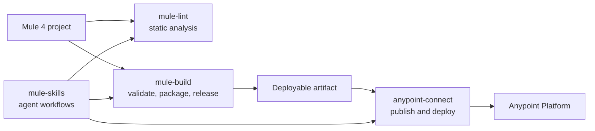

# Ecosystem

`mule-build` is independently versioned. The canonical package matrix, supported combination,
credentials, and end-to-end setup live in the
[mule-skills ecosystem hub](https://avinava.github.io/mule-skills/ecosystem/).

This page documents only the `mule-build` boundary so the compatibility table is not copied across
repositories.

## Where the boundaries are

`mule-build` stops at the artifact. It packages, validates, and versions locally, and it never talks to
Anypoint Platform — deploying a built JAR, reading runtime logs, or rolling back a release is
`anypoint-connect` territory, and that is why only that tool needs credentials.



## Artifact handoff to anypoint-connect

The JAR itself tells a deployer how it was built. Every JAR that `mule-build` packages contains
`META-INF/mule-build/build-info.json` with schema version 1:

```json
{"schemaVersion":1,"tool":"mule-build","toolVersion":"3.2.0","stripped":false,"productionDeployable":true}
```

`productionDeployable` is always the inverse of `stripped`. A `--strip-secure` build is
`productionDeployable: false` and must be refused for a production target. A JAR without the file was
not packaged by `mule-build` 3.2 or later. The [CLI reference](cli.md#build-info-marker) describes each
field.

## mule-build and mule-lint

Both tools look at secrets, at different points:

- `mule-lint` is broad, authoring-time static analysis of source: style, heuristics, and many rules.
- `mule-build enforce` and the `package` gate cover only what ships inside the artifact, and fail only
  on secrets that are clearly present. They work without `mule-lint` installed.

Both tools classify sensitive keys identically, and
`test/fixtures/sensitive-key-vectors.json` holds the shared cases. Connector compatibility
(`MB-CMP-*`) and toolchain checks (`MB-TC-*`) need resolved connector JARs and the local JDK, so only
`mule-build` runs them. Neither tool reads the other's reports or exit codes.

Rules that cover the same ground, as of mule-lint 2.1.0:

| mule-build | mule-lint | Notes |
| --- | --- | --- |
| `MB-SEC-002` | `MULE-201`, `SEC-008` | `SEC-008` covers a literal `secure-properties:config` key |
| `MB-SEC-003` | `CFG-003` (`.properties`), `YAML-004` (YAML) | |
| `MB-SEC-004` | `SEC-019` | Both are warnings |
| `MB-SEC-006` | `SEC-017` | Both are errors |
| `MB-SEC-007` | `SEC-018` | Both are warnings |
| `MB-CMP-005` (descriptor Java vs `minMuleVersion`) | `OPS-005` | mule-lint warns only when no declared Java version is supported |

## A note on the name

The `mule-build` skill in `mule-skills` and this `mule-build` MCP server share a name but are different
things. The skill is a workflow that tells an agent how to validate, package, and release; this server
provides the tools it calls. Either works without the other.

If you install [`mule-skills`](https://avinava.github.io/mule-skills/), this server comes preconfigured
with a pinned version, so there is nothing to set up twice.

## Release and documentation coordination

Package releases remain explicit version-tag releases. Keep `package.json`, both lockfile root
versions, the newest versioned changelog entry, and any versioned examples in agreement. Run
`node scripts/check-release.mjs` before preparing a release; the tag workflow additionally requires
an exact `vX.Y.Z` match and passes the repository checks, dependency audit, and strict documentation
build before publishing. Changes under `Unreleased` do not update a published package automatically.

Choose the next semantic version after reviewing public contract changes. Merge the reviewed version
commit before pushing only its new tag; never move an existing release tag. The compatibility hub
keeps its existing published pins until the new package is available and its compatibility checks pass.
A missing dispatch token requires a manual hub update and does not undo a successful publication.

The documentation site follows the default branch independently of npm releases. Its Pages workflow
builds with `mkdocs build --strict`; manual publication also requires the default branch. A passing
pull-request build validates the proposed docs without publishing them. Tag publication, Pages
deployment, and a hub pin update remain separate operations.
